# Entity Guard for Home Assistant

<a href="https://github.com/italo-lombardi/Home-Assistant-EntityGuard/releases"></a>
<a href="https://github.com/hacs/integration"></a>
<a href="https://github.com/italo-lombardi/Home-Assistant-EntityGuard"></a>
<a href="https://www.home-assistant.io/"></a>
<a href="https://github.com/italo-lombardi/Home-Assistant-EntityGuard/blob/main/LICENSE"></a>

[](https://buymeacoffee.com/italolombardi)
[](https://paypal.me/ItaloLombardi)

[](https://my.home-assistant.io/redirect/hacs_repository/?owner=italo-lombardi&repository=Home-Assistant-EntityGuard&category=integration)
[](https://my.home-assistant.io/redirect/config_flow_start/?domain=entity_guard)

Enforce desired entity state in Home Assistant via declarative rules. Replaces N hand-written auto-off / auto-lock / kill-switch automations with a single rule each, with built-in cooldowns, rate limiting, persistence, and a custom dashboard card.


---

## Features

- **Declarative rules** -- bind 1+ target entities to a trigger and target state; integration enforces it
- **Four rule modes (fixed × dynamic, state × attribute)** -- enforce a target's **state** or an **attribute**, against either a value you **type** (*fixed*) or one read **live from a source entity** (*dynamic*, a.k.a. Follow mode):
  - **Fixed state** -- force an entity to a target state when it enters one of N trigger states
  - **Fixed attribute** -- clamp numeric attributes or match a color target (`rgb_color`, `color_temp_kelvin`)
  - **Dynamic state (Follow mode)** -- the target's on/off follows a source entity; mirror or invert. "Light follows motion" in one rule instead of two
  - **Dynamic attribute (Follow mode)** -- the target's attribute follows a value read live from a source entity
  A *dynamic* mode behaves exactly like its *fixed* counterpart (same debounce, delay, flags, rate limit, suppression, counters, status) — only the target value is read live instead of typed. Because any entity works as a source, you can **bind to a template**: create a [Template helper](https://www.home-assistant.io/integrations/template/) (e.g. a Template binary sensor whose `state` is any Jinja expression) and point a dynamic rule's source at it — the target follows your template's result.
- **Conditional flags** -- list of `(entity, match_state)` conditions AND'd; rule only fires when all match
- **Per-entity cooldown / debounce** -- avoid loop fights with the original cause
- **Per-rule rate limiter** -- cap enforcements/min; auto-suppress on overshoot to break loops
- **Domain-aware service mapping** -- light, switch, lock, cover, media_player, climate, fan, input_boolean
- **Safety acknowledgment** -- explicit confirmation required for cover/lock/climate rules
- **Suppress / unsuppress services** -- temporary pause without disabling the rule
- **Panic stop service** -- emergency disable of every rule + 60 min suppression
- **Master switch (Hub)** -- single global kill-switch across all rules
- **Logbook integration** -- every enforcement, skip, loop detection, and suppression logged
- **Custom Lovelace card** -- per-rule status, counters, controls
- **Self-managed storage** -- no recorder dependency; cooldowns and counters survive restarts
- **No pip dependencies**
- **29 languages** -- UI translated into bg, ca, cs, da, de, el, en, es, fi, fr, hr, hu, it, ja, ko, lt, lv, nb, nl, pl, pt, ro, ru, sk, sv, tr, uk, zh-Hans, zh-Hant

---

## Installation

### HACS (Recommended)

1. Open HACS in your Home Assistant instance.
2. Go to **Integrations** and click the three-dot menu.
3. Select **Custom repositories**.
4. Add `https://github.com/italo-lombardi/Home-Assistant-EntityGuard` with category **Integration**.
5. Click **Install** and restart Home Assistant.

### Manual

1. Download the [latest release](https://github.com/italo-lombardi/Home-Assistant-EntityGuard/releases).
2. Copy the `custom_components/entity_guard/` folder into your `config/custom_components/` directory.
3. Restart Home Assistant.

---

## Configuration

This integration uses a config flow accessible from **Settings > Devices & Services > Add Integration > Entity Guard**.

Adding the integration takes you straight into rule creation. The **Entity Guard Hub** (global master switch) is created automatically the first time you save a rule — no separate setup step required.

### Step 1: Rule Basics

| Field | Description |
|-------|-------------|
| Rule name | A descriptive name for the rule (e.g., "Front door auto-lock") |
| Target entities | One or more entities the rule will enforce |
| Mode | One of four: **Fixed state** (force a state you pick), **Fixed attribute** (clamp a numeric attribute / match a color you pick), **Dynamic state (Follow mode)** (on/off follows a source entity), or **Dynamic attribute (Follow mode)** (an attribute follows a value read live from a source entity) |

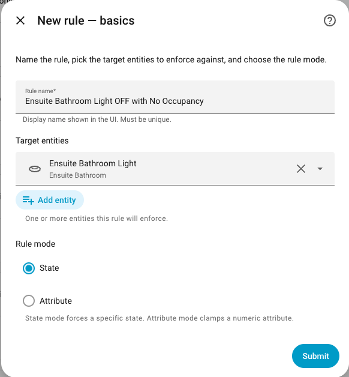

### Step 2a: Fixed State Mode

| Field | Default | Description |
|-------|---------|-------------|
| Trigger states | `["on"]` | One or more states that trigger enforcement |
| Target state | `off` | State to force the entity into |
| Delay (seconds) | `0` | Wait this long after the trigger before enforcing (0-86400) |

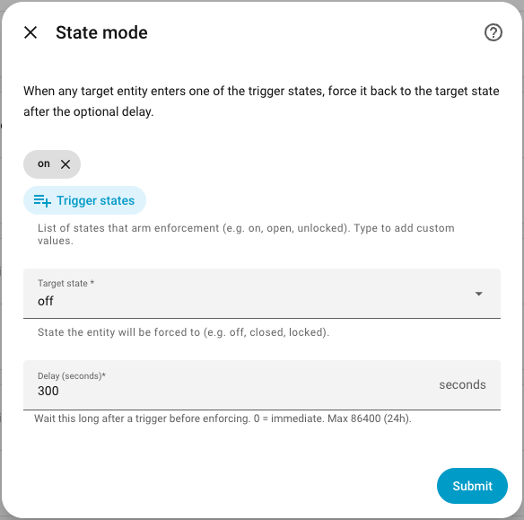

### Step 2b: Fixed Attribute Mode

Fixed attribute mode is configured in two screens. First choose **which** attribute to enforce; the parameters screen then adapts to that choice.

**Choose the attribute**

| Field | Description |
|-------|-------------|
| Attribute | `brightness`, `volume_level`, `temperature`, `percentage`, `rgb_color`, or `color_temp_kelvin` (color attributes appear only for entities whose domain supports them) |

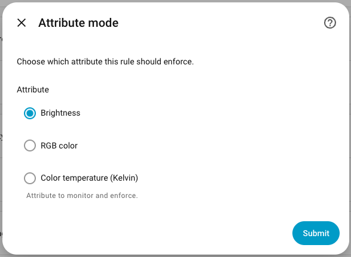

**Attribute parameters**

The fields on this screen depend on the attribute you picked.

*Numeric attributes* (`brightness`, `volume_level`, `temperature`, `percentage`) use a **clamp** model:

| Field | Description |
|-------|-------------|
| Operator | `<`, `<=`, `>`, `>=` — the comparison that triggers a clamp |
| Threshold | Numeric value compared against the live attribute |
| Target value | Value to clamp the attribute to when the rule fires |
| Delay (seconds) | Wait this long before enforcing (0-86400) |

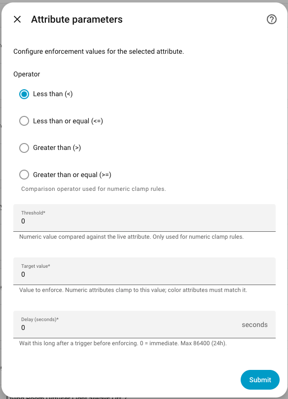

*Color attributes* (`rgb_color`, `color_temp_kelvin`) use a **match** model instead — no operator or threshold, just a target the light must match:

| Field | Description |
|-------|-------------|
| Target value | RGB color (picker) or color temperature in Kelvin (slider) the light must match |
| Delay (seconds) | Wait this long before enforcing (0-86400) |

If the light is on and its current color differs from the target beyond a small tolerance, the rule calls `light.turn_on` with the target color. Lights that are off or unavailable are skipped — Entity Guard will not turn them on just to enforce color.

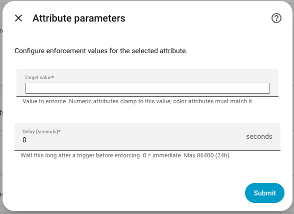

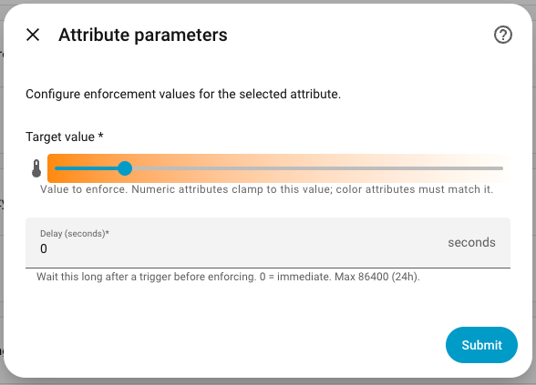

### Step 2c: Dynamic State Mode (Follow mode)

Dynamic state binds the target's **on/off** to a live value read from a **source** entity, instead of fixed trigger/target states. It behaves exactly like Fixed state — same delay, debounce, flags, rate limit, status — only the desired on/off is read live.

| Field | Description |
|-------|-------------|
| Source entity | The entity the target(s) follow. Must not be one of the target entities. |
| Read value from | **State** (default) — use the source's on/off state. **Attribute** — use one of the source's attributes instead. |
| Source attribute | *(only when reading from an attribute)* Name of the source attribute to read. Its value is reduced to on/off: a non-zero number, or an on-ish state string, is **on**; `0`, an off-ish word, or empty is **off**. |
| Invert | Off (default) = *mirror* (source on → target on). On = *invert* (source on → target off). |
| Delay (seconds) | Wait this long before enforcing (0-86400) |

Source on/off (when reading the **state**) is derived from a documented set of "on-ish" states (`on`, `home`, `open`, `unlocked`, `playing`, `active`, `cleaning`, `mowing`, `true`, `1`); any other live state is treated as off. When the source is `unavailable`/`unknown` (or a chosen source attribute is missing), the rule holds — no enforcement, no error. Enforcement is idempotent: the target changes only when its current on/off differs from the source-derived value.

> **Tip — bind to a template.** Any entity can be a source, including a [Template helper](https://www.home-assistant.io/integrations/template/). Create a Template binary sensor whose `state` is any Jinja expression (combine several sensors, add time windows, whatever), then point a dynamic rule's source at that helper — the target now follows your template's result, with all of Entity Guard's debounce / delay / conditions / rate-limiting on top.

<!-- SCREENSHOT PLACEHOLDER: replace with latest UX. -->


### Step 2d: Dynamic Attribute Mode (Follow mode)

Dynamic attribute binds a target **attribute** to a live value read from a **source** entity. It behaves exactly like Fixed attribute (acts while the target is on, color matching within tolerance) — only the value is read live instead of typed.

| Field | Description |
|-------|-------------|
| Source entity | The entity the target(s) follow. Must not be one of the target entities. |
| Read value from | **State** — use the source's state as the value. **Attribute** — use one of the source's attributes. |
| Source attribute | *(only when reading from an attribute)* Name of the source attribute to read. |
| Attribute | The **target** attribute to drive (`brightness`, `volume_level`, `temperature`, `percentage`, `rgb_color`, `color_temp_kelvin`). |
| Delay (seconds) | Wait this long before enforcing (0-86400) |

The read value is copied to the target attribute as-is (v1: raw copy, no range scaling — make sure the source value's type and range suit the target attribute, e.g. a 0–255 brightness). The rule acts only while the target is on; a source that is unavailable/unknown, or a missing source attribute, holds the rule. Enforcement is idempotent: the target changes only when its current attribute value differs from the live source value (color within tolerance).

<!-- SCREENSHOT PLACEHOLDER: replace with latest UX. -->


### Step 2e: Optional Features

Tick any features to configure. Each ticked option adds a follow-up screen. Skip all to go straight to review.

| Option | Description |
|--------|-------------|
| Add extra conditions | Require flag conditions (e.g. only enforce when nobody is home, only after sunset). Leave unticked to enforce every time the trigger fires. |
| Customize loop protection | Auto-suppresses the rule if it fires more than 10 times/min by default. Tick to set your own limit, or to disable loop protection entirely. |
| Enable debounce | Ignore quick back-and-forth changes. The rule only acts if the trigger stays the same for the debounce window. |

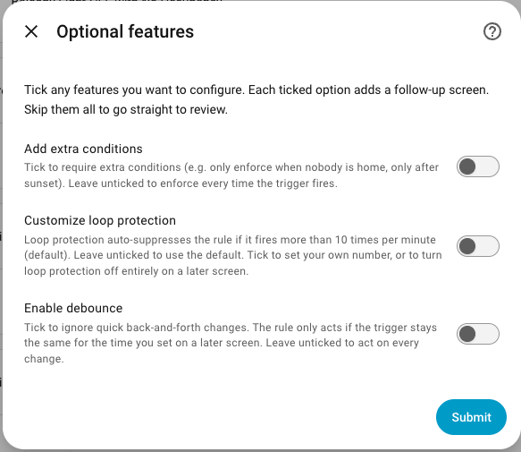

### Step 3: Flags (optional)

Define a list of `(flag entity, match state)` conditions. The rule only fires when **all** flags match. Unavailable flag entities count as a mismatch (fail-safe).

Example: a curfew flag (`input_boolean.kids_curfew == "on"`) AND a presence flag (`person.parent == "not_home"`).

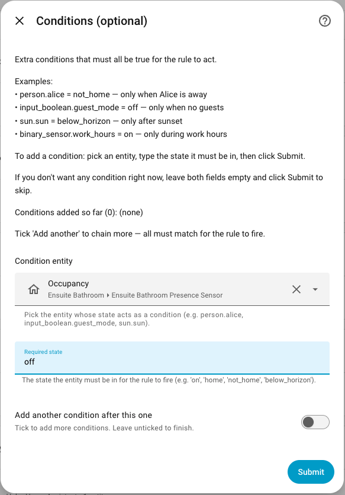

When editing a rule's flags via **Configure → Edit flag conditions**, you have four actions:

- **Add** — append the new condition to the existing list
- **Replace** — clear all existing conditions and save only the new one
- **Clear** — remove all conditions
- **Exit without changes** — leave the list as-is

If a flag entity is later deleted from Home Assistant, Entity Guard surfaces a **Repair issue** (Settings → System → Repairs) so you know which rule references the missing entity. The rule will not enforce while flags cannot be evaluated.

### Step 4: Advanced

| Field | Default | Description |
|-------|---------|-------------|
| Debounce enabled | `false` | Suppress repeat enforcement within the debounce window |
| Debounce (seconds) | `60` | Window during which a re-trigger is ignored (0-86400) |
| Max enforcements per minute | `10` | Auto-suppresses the rule for 15 minutes if exceeded. Set to `0` to disable the rate limiter entirely. |

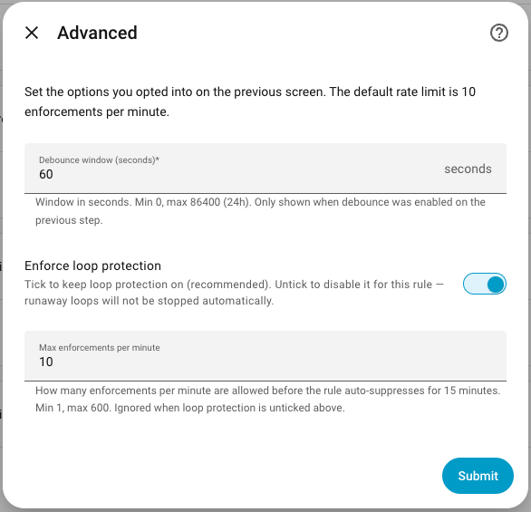

### Step 5: Safety Acknowledgment (cover / lock / climate only)

If any target entity is in the `cover`, `lock`, or `climate` domain, you must check the safety acknowledgment box before the rule can be saved. This is a deliberate seatbelt against rules that physically move things.

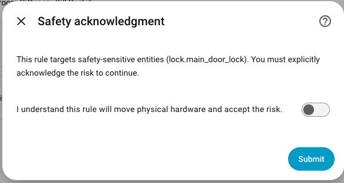

### Step 6: Preview

Review the assembled rule before saving. Confirm to create the config entry. The Entity Guard Hub is created automatically alongside your first rule.

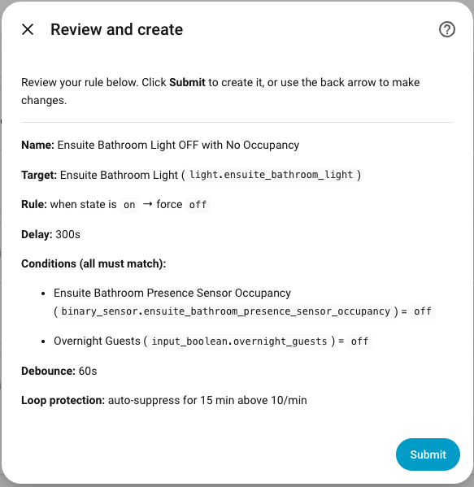

---

## Entities created per rule

**Visible by default**

| Entity | Description |
|--------|-------------|
| `switch.<rule>_enabled` | Master toggle for this rule |
| `switch.<rule>_debounce_enabled` | Toggle the debounce window |
| `number.<rule>_delay_seconds` | Delay before enforcing |
| `number.<rule>_debounce_seconds` | Debounce window length |
| `number.<rule>_max_enforcements_per_minute` | Per-rule rate limit (set `0` to disable) |
| `binary_sensor.<rule>_armed` | Rule is watching (flag matched, master/enabled on) |
| `binary_sensor.<rule>_active` | Service call currently in flight |
| `binary_sensor.<rule>_in_cooldown` | Cooldown active for at least one bound entity |
| `binary_sensor.<rule>_recently_enforced` | ON for 30 s after any enforcement; pulses off→on on repeated enforce. Attributes: `rule_name`, `target_entities`, `target_entity_names`, `target`, `delay_seconds` |
| `sensor.<rule>_status` | Enum: `error` > `disabled` > `suppressed` > `enforcing` > `cooldown` > `armed` > `conditional` > `starting` > `pending` |
| `sensor.<rule>_last_enforced` | Timestamp of the last successful enforcement |
| `sensor.<rule>_enforcement_count_today` | Resets at local midnight |
| `button.<rule>_reset` | Clear all cooldowns for this rule |
| `button.<rule>_test_enforce` | Force an enforcement once (for testing) |

**Hidden by default** (enable manually in entity registry)

| Entity | Description |
|--------|-------------|
| `sensor.<rule>_rule_id` | Stable config-entry ID — use in automations instead of rule name |
| `sensor.<rule>_enforcement_count_total` | Lifetime enforcement count. Attributes: `counter_since` (ISO timestamp when the window opened — rule creation or last Clear History), `counter_days` (whole days from `counter_since` to now) |
| `sensor.<rule>_cooldown_remaining` | Seconds left on current cooldown |
| `sensor.<rule>_safety_status` | Visible only for cover/lock/climate rules |
| `sensor.<rule>_suppressed_until` | Timestamp when suppression ends |
| `sensor.<rule>_blocked_entities` | Count + list of entities currently in cooldown |

> The three `number.*` sliders (delay, debounce, max enforcements) persist their values across Home Assistant restarts and reloads. Adjusting a slider takes effect immediately and survives a restart. Opening the rule's options flow shows each slider's current (persisted) value, and saving only changes the fields you edit — an unedited slider keeps its value.

---

## Hub entity (global)

| Entity | Description |
|--------|-------------|
| `switch.entity_guard_master_enabled` | Global kill-switch. When off, every rule is `disabled`. |

---

## Status state machine

`sensor.<rule>_status` reports one of ten values, by priority (highest wins):

1. `error` -- 3+ consecutive enforcement failures (e.g. target unavailable). Auto-clears on next success or via `clear_history`.
2. `master_disabled` -- hub master switch is OFF (overrides every per-rule state below)
3. `disabled` -- per-rule `enabled=OFF`
4. `suppressed` -- suppress service active
5. `enforcing` -- service call currently in flight (transient)
6. `cooldown` -- post-enforcement cooldown active
7. `pending` -- delayed enforcement armed, waiting on `delay_seconds`
8. `armed` -- flags match, watching
9. `conditional` -- one or more flag entities do not match required state
10. `starting` -- inside the startup grace window

---

## Services

| Service | Description |
|---------|-------------|
| `entity_guard.suppress` | Pause a rule for `duration_minutes` (1-1440). Auto-resumes. |
| `entity_guard.unsuppress` | Resume a suppressed rule immediately. |
| `entity_guard.list_rules` | Return every rule's config + current status (response service). |
| `entity_guard.clear_history` | Clear cooldowns, counters, and last-enforced for a rule. |
| `entity_guard.panic_stop` | Disable every rule, suppress 60 min, turn off the master switch. |

> **Suppress vs Unsuppress**: `unsuppress` has a dedicated button on each rule's device page and card.
> `suppress` requires a service call (Developer Tools → Services, or an automation) because it takes a
> `duration_minutes` parameter — buttons cannot accept input. Use the card's **Suppress 1h** button for
> a quick 60-minute suppress, or call the service directly for a custom duration.

---

## Events

Every rule action fires a Home Assistant event:

| Event | Fired when |
|-------|------------|
| `entity_guard_enforced` | Successful enforcement |
| `entity_guard_skipped` | Enforcement skipped (see `reason` below) |
| `entity_guard_loop_detected` | Rate limit hit; rule auto-suppressed |
| `entity_guard_suppressed` | Suppress service called |

All four are described in the Logbook.

`entity_guard_skipped` carries a `reason` field:

| `reason` | Meaning |
|----------|---------|
| `no_service_mapping` | No service known for the target's domain/attribute |
| `service_call_failed` | The enforcing service call raised (also sets `error`) |
| `light_off` | Color rule: target light is off (not turned on to enforce color) |
| `light_unavailable` | Color rule: target light is `unavailable`/`unknown` |
| `attribute_unavailable` | Color rule: target's color attribute is missing/unreadable |

---

## Examples

### Light follows motion (Dynamic state)

| Setting | Value |
|---------|-------|
| Target entities | `light.hallway` |
| Mode | Dynamic state (Follow mode) |
| Source entity | `binary_sensor.hallway_motion` |
| Read value from | State |
| Invert | off (mirror) |
| Delay (seconds) | `0` |

Motion `on` → light on; motion `off` → light off. Replaces the previous two-rule setup (one turn-on rule, one turn-off rule). Add a debounce or a delay to hold the light briefly after motion clears.

### Nursery light follows a template helper (Dynamic state)

| Setting | Value |
|---------|-------|
| Target entities | `light.nursery` |
| Mode | Dynamic state (Follow mode) |
| Source entity | `binary_sensor.nursery_should_be_on` (a Template helper) |
| Read value from | State |
| Invert | off (mirror) |

`binary_sensor.nursery_should_be_on` is a [Template binary sensor](https://www.home-assistant.io/integrations/template/) whose state is any Jinja expression (e.g. "someone home AND after sunset AND before 22:00"). The nursery light's on/off follows that result — a single dynamic-state rule binds a light to an arbitrarily complex template.

### Under-cabinet lights track the main light's brightness (Dynamic attribute)

| Setting | Value |
|---------|-------|
| Target entities | `light.under_cabinet` |
| Mode | Dynamic attribute (Follow mode) |
| Source entity | `light.kitchen_main` |
| Read value from | Attribute |
| Source attribute | `brightness` |
| Attribute (target) | `brightness` |

While `light.under_cabinet` is on, its brightness tracks `light.kitchen_main`'s `brightness` attribute live. The value is copied as-is (both are 0–255 brightness), so the two lights stay in sync. Pair with a Dynamic state rule on the same source if you also want the under-cabinet light to turn on/off with the main light.

### Exhaust fan opposite a humidity switch (Dynamic state, invert)

| Setting | Value |
|---------|-------|
| Target entities | `switch.bathroom_fan` |
| Mode | Dynamic state (Follow mode) |
| Source entity | `input_boolean.humidity_ok` |
| Read value from | State |
| Invert | on |

When humidity is OK the fan is off; when not OK (`input_boolean.humidity_ok` off) the fan turns on — invert flips the state direction.

### Auto-lock front door 10 seconds after unlock

| Setting | Value |
|---------|-------|
| Target entities | `lock.front_door` |
| Mode | Fixed state |
| Trigger states | `unlocked` |
| Target state | `locked` |
| Delay (seconds) | `10` |
| Debounce | enabled, 30s |
| Safety acknowledged | yes |

### Kids' TV off after curfew

| Setting | Value |
|---------|-------|
| Target entities | `media_player.kids_tv` |
| Mode | Fixed state |
| Trigger states | `on`, `playing`, `paused` |
| Target state | `off` |
| Flags | `input_boolean.kids_curfew == on` |

### Diffuser low-water lockout

| Setting | Value |
|---------|-------|
| Target entities | `switch.diffuser_mist` |
| Mode | Fixed state |
| Trigger states | `on` |
| Target state | `off` |
| Flags | `binary_sensor.diffuser_water_low == on` |

### Brightness clamp at night

| Setting | Value |
|---------|-------|
| Target entities | `light.kids_bedroom` |
| Mode | Fixed attribute |
| Attribute | `brightness` |
| Operator | `>` |
| Threshold | `64` |
| Target value | `64` |
| Flags | `input_boolean.night_mode == on` |

### Force living-room lights to warm white after sunset

| Setting | Value |
|---------|-------|
| Target entities | `light.living_room_lamps` |
| Mode | Fixed attribute |
| Attribute | `color_temp_kelvin` |
| Target value | `2700` |
| Delay (seconds) | `0` |
| Flags | `sun.sun == below_horizon` |

### Lock accent strip to red

| Setting | Value |
|---------|-------|
| Target entities | `light.accent_strip` |
| Mode | Fixed attribute |
| Attribute | `rgb_color` |
| Target value | `[255, 0, 0]` |
| Delay (seconds) | `0` |

---

## Lovelace card

The custom card auto-registers when the integration loads. Add it to a dashboard with:

```yaml
type: custom:entity-guard-card
rule_id: <config_entry_id>
title: "Living Room"        # optional override
show_stats: true             # default: true  (enforcement counters)
show_last_enforced: true     # default: true
show_entities: true          # default: true
show_conditions: false       # default: false
show_config: false           # default: false (delay, debounce, loop protection)
show_actions: false          # default: false
```

The card shows:
- Rule name and color-coded status badge (armed / enforcing / suppressed / cooldown / conditional / error / master_disabled)
- Enforcement counters (today / total) — togglable via `show_stats`
- Last enforced timestamp and cooldown indicator — togglable via `show_last_enforced`
- Bound entities with compliance state (✓ compliant / ⚠ violation); state values show translated labels where HA's device_class provides one — `Clear (off)`, `Detected (on)` — or label-only when the label is just a capitalised raw value (`Off`); non-compliant rows translate both sides: `Detected (on) → Clear (off) ⚠`. **Clicking any entity row opens the HA more-info dialog for that entity.** When status is `pending`, a live countdown row appears under each entity that is awaiting enforcement — e.g. `⏱ Enforcing in 14 s` — ticking every second and disappearing once the rule fires or conditions clear.
- Optional **Conditions** section (`show_conditions: true`) — lists each flag with current vs required state translated the same way; useful when status is `conditional`. **Each condition row is also clickable** (opens more-info for the flag entity).
- Optional **Configuration** section (`show_config: true`) — shows Delay, Debounce ("Disabled" when off), and Loop protection ("auto-suppress for 15 min above N/min" when on) for the rule.
- Optional action buttons (Test Enforce, Reset Cooldowns when active, Clear History, Suppress 1h)

**Normal state — rule idle**

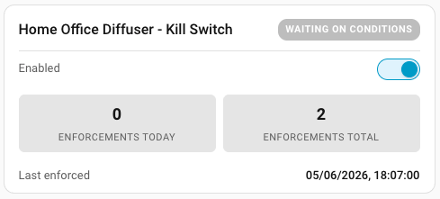

**Armed state — rule watching**

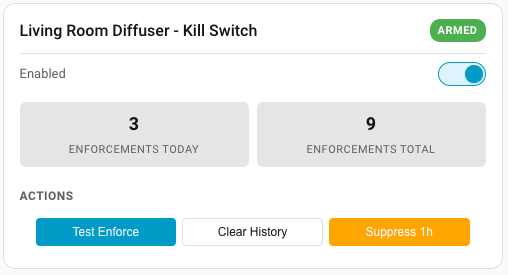

**Suppressed state**

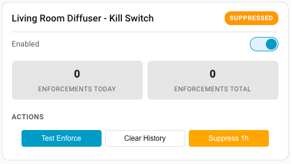

**Actions panel open**

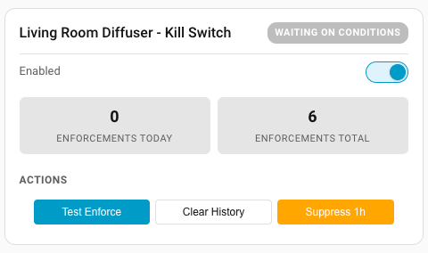

**Card editor**

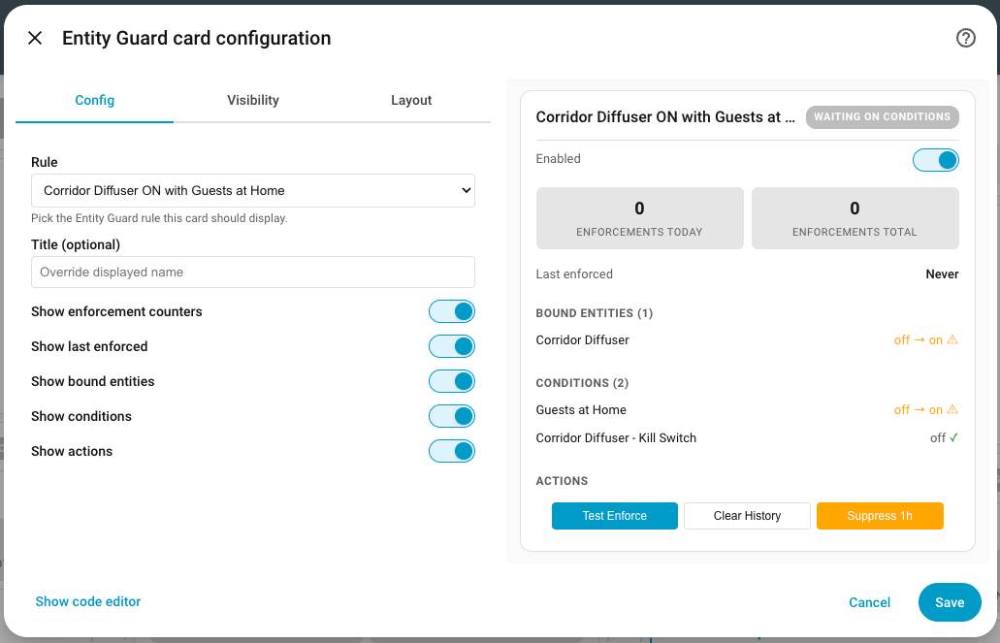

### Dashboard Example

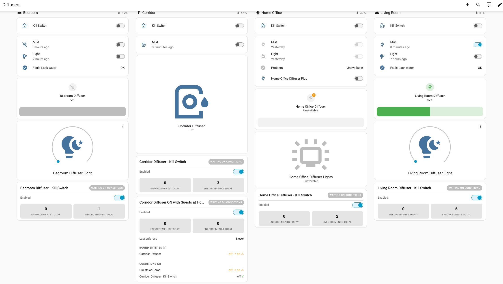

---

## Automations

See **[AUTOMATION_EXAMPLES.md](AUTOMATION_EXAMPLES.md)** for a full library of copy-paste automation examples covering notifications, rule control, enforcement reactions, and dashboard counters.

Quick reference — two most common patterns:

### Notify when a rule enforces (event-based, rename-safe)

Filter by `rule_id` from `sensor.<rule>_rule_id` (enable it in the entity registry first).

```yaml
automation:
  alias: Notify on enforcement
  trigger:
    - platform: event
      event_type: entity_guard_enforced
      event_data:
        rule_id: "01KSXDM1GN9WGQCSTFAX0Y1HNS"
  action:
    - service: notify.mobile_app_my_phone
      data:
        message: >
          {{ trigger.event.data.rule_name }} enforced
          {{ trigger.event.data.entity_id }} → {{ trigger.event.data.target }}
```

### Trigger on recently_enforced sensor (state-based)

`binary_sensor.<rule>_recently_enforced` turns ON for 30 seconds after any enforcement and pulses off→on on repeated fires.

```yaml
automation:
  alias: React to enforcement
  trigger:
    - platform: state
      entity_id: binary_sensor.my_rule_recently_enforced
      to: "on"
  action:
    - service: notify.mobile_app_my_phone
      data:
        message: >
          {{ state_attr('binary_sensor.my_rule_recently_enforced', 'rule_name') }}
          enforced {{ state_attr('binary_sensor.my_rule_recently_enforced', 'target_entities') | join(', ') }}
          → {{ state_attr('binary_sensor.my_rule_recently_enforced', 'target') }}
```

---

## FAQ

**Q: Does this integration require the Recorder component?**
A: No. Entity Guard uses its own `.storage` file for cooldowns and counters. Counters survive HA restarts.

**Q: What happens at HA startup?**
A: Rules are dormant for the first 60 seconds (startup grace). After that, every armed rule re-evaluates against current state and enforces if needed.

**Q: Multiple rules on the same entity -- what happens?**
A: They run independently. The per-rule rate limiter catches any thrash. A warning is shown at config time when this is detected.

**Q: A rule keeps fighting an automation. How do I diagnose?**
A: Watch for the `entity_guard_loop_detected` event in Logbook -- the rate limiter will auto-suppress the rule and fire it. Either raise `max_enforcements_per_minute`, add a debounce, or fix the conflicting automation.

**Q: How do I get notified when a rule fires?**
A: Two options — see the [Automations](#automations) section for full YAML examples. Either listen to the `entity_guard_enforced` event (filter by `rule_id` for rename-safe targeting) or use the `binary_sensor.<rule>_recently_enforced` sensor as a state-change trigger. The integration intentionally does not include built-in notifications — you already have a notify service.

**Q: Does the test_enforce button do a dry-run?**
A: No -- it actually runs the configured enforcement. Use it on test entities or while the rule's `enabled` switch is off (which still allows test_enforce).

**Q: Why no `==` / `!=` operators in attribute mode?**
A: Float precision. `state == 0.5` is false more often than you'd expect on real sensor reports. Use `<=` / `>=` instead.

**Q: Can I suppress a rule indefinitely?**
A: No -- `suppress` requires a duration. For permanent pause, turn the rule's `enabled` switch off.

**Q: How do I read all sensor values in templates?**
A: Use `states()` for the main value and `state_attr()` for attributes. Example: `{{ state_attr('sensor.entity_guard_front_door_blocked_entities', 'entities') }}`.

---

## Contributing

Contributions are welcome! Please:

1. Fork the repository.
2. Create a feature branch (`git checkout -b feature/my-feature`).
3. Commit your changes with clear commit messages.
4. Open a Pull Request against `main`.

### Development Setup

```bash
git clone https://github.com/italo-lombardi/Home-Assistant-EntityGuard.git

python -m venv venv
source venv/bin/activate

pip install homeassistant pytest pytest-homeassistant-custom-component
```

### Running Tests

```bash
python -m pytest tests/ -v
```

### Guidelines

- Follow the [Home Assistant integration development guidelines](https://developers.home-assistant.io/).
- Add translations for any new user-facing strings.
- Write tests for new functionality.
- Keep PRs focused -- one feature or fix per PR.

---

## Sibling integrations

Other Home Assistant integrations by the same author:

| Integration | Description |
|-------------|-------------|
| [Entity Availability](https://github.com/italo-lombardi/Home-Assistant-EntityAvailability) | Monitor entity availability by group — tracks offline entities, availability history, and degraded states with a custom dashboard card |
| [Entity Distance](https://github.com/italo-lombardi/Home-Assistant-EntityDistance) | Tracks distance between 2–5 HA entities (persons, devices, zones) — direction, closing speed, ETA, proximity, group sensors |
| [Entity State Tracker](https://github.com/italo-lombardi/Home-Assistant-EntityStateTracker) | Tracks time-in-state and transitions across time frames — per-state breakdowns and compliance scoring, with a custom card |
| [Fuel Compare](https://github.com/italo-lombardi/Home-Assistant-FuelCompare) | Live fuel prices from 36 providers across 30 countries |
| [WashWise](https://github.com/italo-lombardi/Home-Assistant-WashWise) | Decide whether to wash your car, bike, or solar panels based on the weather forecast — verdict, 0–100 score, and per-day breakdown |
| [DashSnap](https://github.com/italo-lombardi/DashSnap) | Record or screenshot any web page via headless Chromium — HA dashboards, Grafana, public pages; HA Add-on or Docker |
| [DashSnap Integration](https://github.com/italo-lombardi/DashSnap-Integration) | Trigger DashSnap recordings and screenshots from HA automations and scripts |

---

## License

GPL-3.0. See `LICENSE`.
